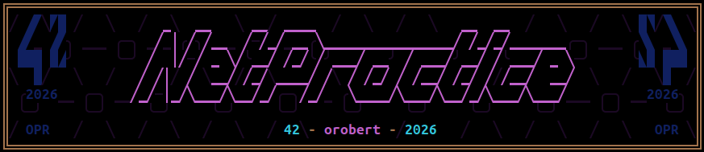
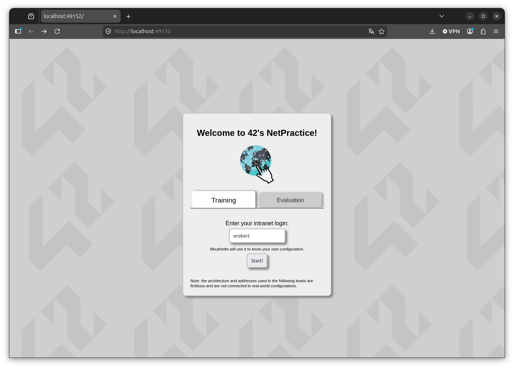
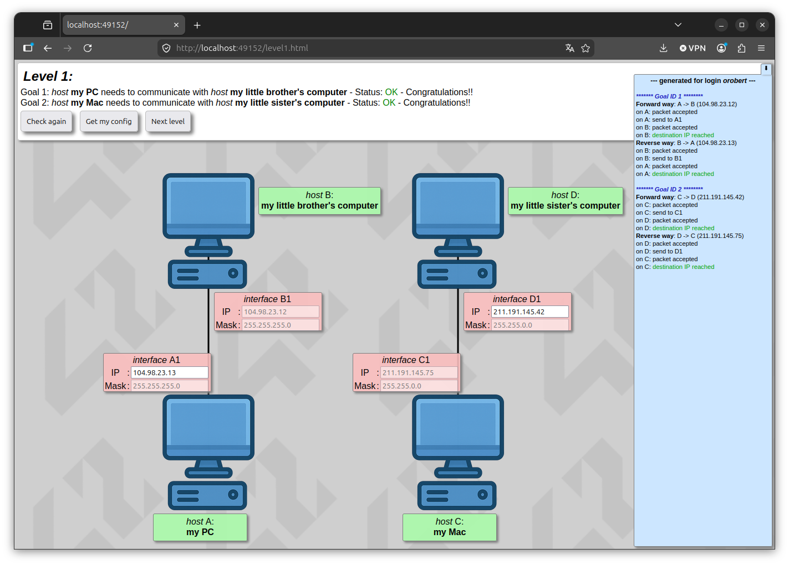

_This project has been created as part of the 42 curriculum by **orobert**._



$${\color{teal}⋘⊛⋙}$$
# **$${\color{orange}1. \space Description}$$**
**NetPractice** is an introduction to computer networking and TCP/IP addressing.

The goal of the project is to solve multiple network configuration exercises by fixing invalid or incomplete network setups.  
Each exercise requires understanding how hosts, routers, subnet masks, and gateways interact in order to establish proper communication between machines and external networks.

This project focuses on fundamental networking concepts such as:

- IPv4 addressing
- subnet masks and CIDR notation
- routing tables
- default gateways
- local and remote network communication
- routers and packet forwarding
- TCP/IP basics
- OSI model fundamentals

The project is composed of 10 training levels that must all be completed successfully.

$${\color{teal}⋘⊛⋙}$$
# **$${\color{orange}2. \space Instructions}$$**
## **$${\color{violet}2.1. \space Running \space the \space training \ interface}$$**
Download and extract the project archive provided on the 42 intra.

Then run:

```bash
./run.sh
```

This script launches a local web server and automatically opens the **NetPractice** interface in your web browser.

If the script does not work properly, the interface can also be started manually:

```bash
python3 -m http.server 49242
```

Then open:
```bash
http://localhost:49242
```
in your web browser.




## **$${\color{violet}2.2. \space Completing \space the \space exercises}$$**
For each level:

- Analyze the network topology
- Fix incorrect IP addresses, masks, routes, or gateways
- Use the **Check again** button to validate the configuration
- Export the configuration using **Get my config**



## **$${\color{violet}2.3. \space Submission \space details}$$**
The repository must contain:

- 10 exported configuration JSON files (one per level)
- README.md

All exported files had to be placed at the root of the repository.
The student's login must have been entered in the training interface before exporting the configurations.

Also, a *md_pictures* folder contains illustrations for this documentation.

$${\color{teal}⋘⊛⋙}$$
# **$${\color{orange}3. \space Networking \space Concepts \space Studied}$$**
## **$${\color{violet}3.1. \space IPv4 \space Addressing}$$**
Understanding how IP addresses identify hosts inside a network.

Example:
```bash
192.168.1.42/24
```

## **$${\color{violet}3.2. \space Subnet \space Masks}$$**
Using subnet masks to determine:

- network addresses
- broadcast addresses
- valid host ranges
- local vs remote communication

Examples:
| CIDR | Mask | Binary | Network slots
|---|---|---|---|
| /24 | 255.255.255.0 | 11111111111111111111111100000000 | 254 |
| /25 | 255.255.255.128 | 11111111111111111111111110000000 | 126 |
| /26 | 255.255.255.192 | 11111111111111111111111111000000 | 62 |
| /30 | 255.255.255.252 | 11111111111111111111111111111100 | 2 |

## **$${\color{violet}3.3. \space Routing}$$**
Understanding how routers forward packets between different networks using routing tables.

Example:

```bash
0.0.0.0/0 -> 192.168.1.1
```

## **$${\color{violet}3.4. \space Default \space Gateway}$$**
Understanding the role of the default gateway when a destination is outside the local network.

## **$${\color{violet}3.5. \space Routers \space and \space Switches}$$**
Learning the difference between:

- direct local communication
- routed communication through gateways
- inter-network forwarding

## **$${\color{violet}3.6. \space OSI \space and \space TCP/IP \space Models}$$**
Basic understanding of:

- Layer 2 _(Data Link)_
- Layer 3 _(Network)_
- IP packet forwarding
- logical addressing

$${\color{teal}⋘⊛⋙}$$
# **$${\color{orange}4. \space Contributors}$$**
- **orobert** aka **_OPR_**\
    _**NetPractice** project_
- **ChatGPT**\
    _proofreading of this documentation_
- **Students** from **School 42 Mulhouse**\
    _brainstorming, coffee and moral support_

$${\color{teal}⋘⊛⋙}$$
# **$${\color{orange}5. \space Resources}$$**
## Documentation on Wikipedia
- [IPv4](https://en.wikipedia.org/wiki/IPv4)
- [Subnetwork](https://en.wikipedia.org/wiki/Subnetwork)
- [Routing](https://en.wikipedia.org/wiki/Routing)
- [Router (computing)](https://en.wikipedia.org/wiki/Router_(computing))
- [OSI model](https://en.wikipedia.org/wiki/OSI_model)

## Useful Tools
- [IP/Subnet calculator](https://ipcalc.info)
- [CIDR calculator](https://cidr.xyz)

$${\color{teal}⋘⊛⋙}$$
# **$${\color{magenta}Thanks \space for \space your \space time}$$**
$${\color{teal}⋘⊛⋙}$$

###### $${\color{darkgrey}_i\space_f\space\space\space_y\space_o\space_u\space\space\space_c\space_a\space_n\space\space\space_r\space_e\space_a\space_d\space\space\space_t\space_h\space_i\space_s\space_,\space\space\space_y\space_o\space_u\space\space\space_d\space_o\space_n\space_`\space_t\space\space\space_n\space_e\space_e\space_d\space\space\space_g\space_l\space_a\space_s\space_s\space_e\space_s\space_.}$$
